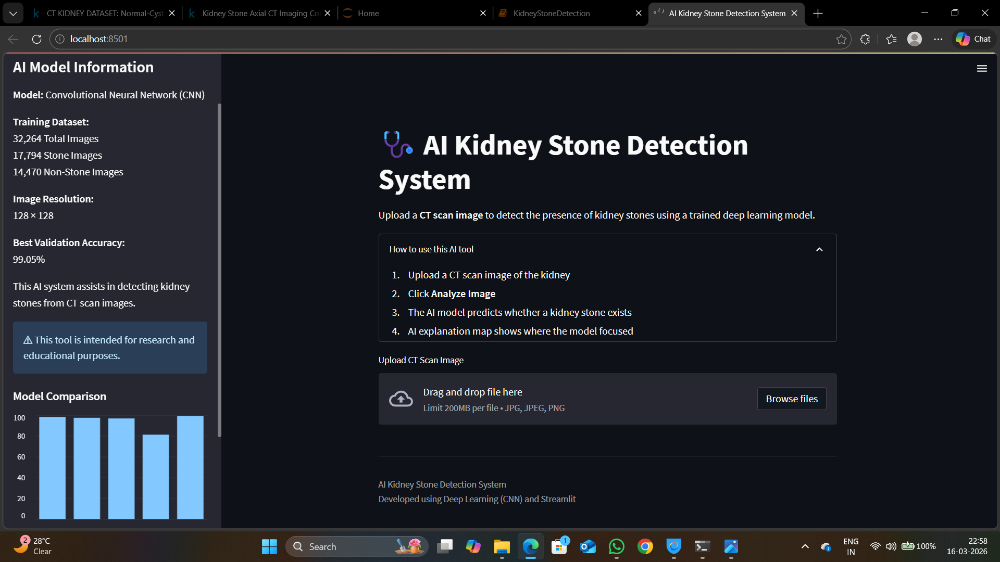
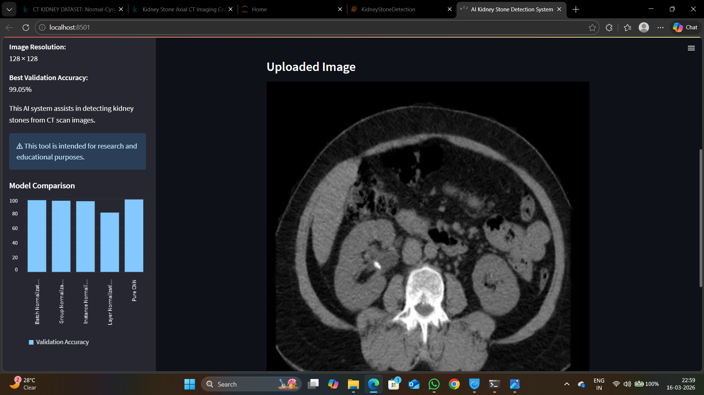
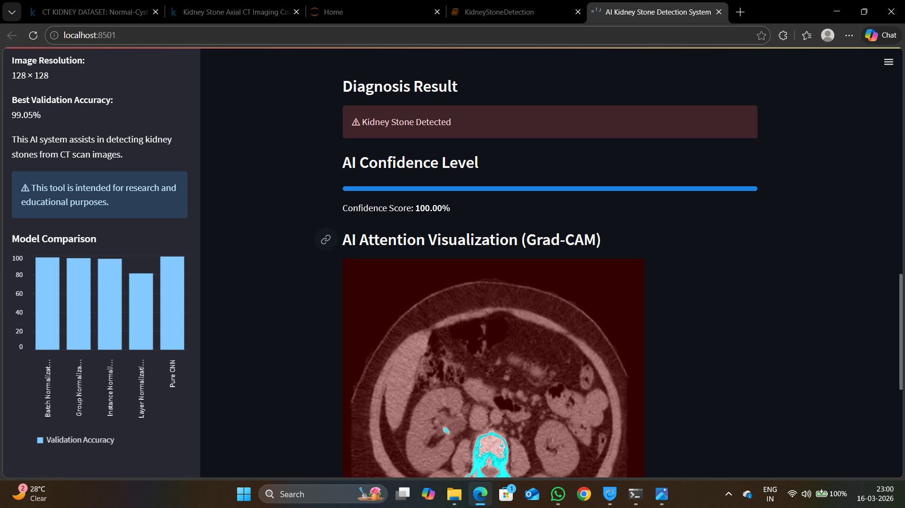
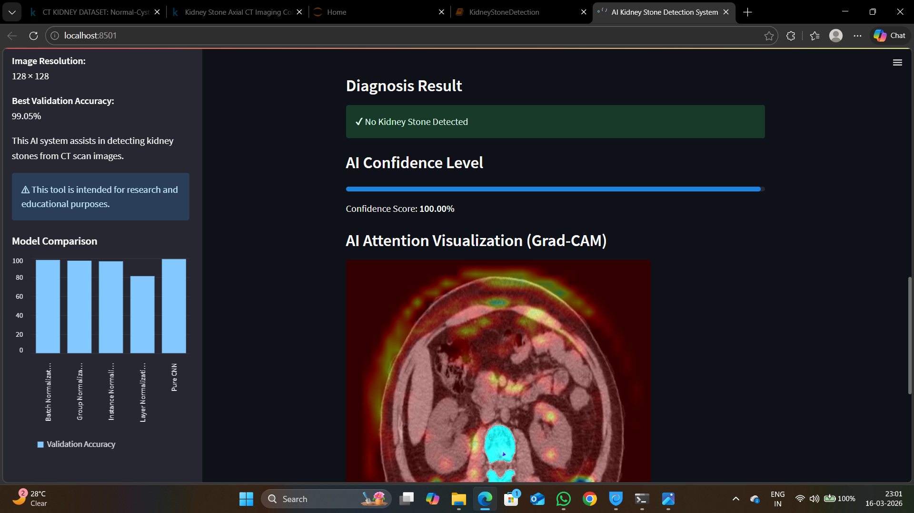

***# AI Kidney Stone Detection System***

This project uses Deep Learning (Convolutional Neural Networks) and Computer Vision to detect kidney stones from Axial CT Scan Images.

The system allows users to upload a CT scan image and automatically predicts whether a kidney stone is present or not using a trained CNN model.

The application is deployed using Streamlit and provides an interactive interface for testing CT images.

\---

**Model Information:**

Model Type: Convolutional Neural Network (CNN)

Input Image Size: 128 × 128 pixels

**Training Dataset:**

\- 32,264 CT Scan Images

\- 17,794 Stone Images

\- 14,470 Non-Stone Images

The model was trained and evaluated using multiple normalization techniques to compare performance.

The model was trained using the "Axial CT Imaging Dataset for AI-Powered Kidney Stone Detection", a medical dataset designed for deep learning research.

Dataset size: "2.16 GB"

Due to GitHub storage limitations, the dataset is not included in this repository.

You can download the dataset from the following source:

Dataset Link:

https://data.mendeley.com/datasets/fwhytt5mzd/2

After downloading, extract the dataset and update the dataset path in the training script if needed.

**Model Pipeline:**

The AI kidney stone detection system follows the pipeline below:

1\. Input Image Upload

&#x20;

&#x20;  - User uploads a kidney CT scan image through the Streamlit interface.

2\. Image Preprocessing

&#x20;

&#x20;  - Image is resized to 128 × 128 pixels

&#x20;  - Pixel values are normalized for CNN input.

3\. Deep Learning Model

&#x20;

&#x20;  - A Convolutional Neural Network (CNN) processes the image.

&#x20;  - The model extracts spatial features using convolution and pooling layers.

4\. Prediction

&#x20;

&#x20;  - The trained CNN classifies the CT scan as:

&#x20;    - Stone

&#x20;    - Non-Stone

5\. Result Display

&#x20;

&#x20;  - The predicted result is displayed on the Streamlit web interface.

**Model Architecture (Simplified):**

Input Image (128×128)

↓

Convolution Layers

↓

Activation (ReLU)

↓

Pooling Layers

↓

Fully Connected Layer

↓

Output Layer (Stone / Non-Stone)

**Model Comparison Results:**

Five CNN variants were trained and evaluated:

| Model | Validation Accuracy |

|------|--------------------|

| Pure CNN | \*\*99.05%\*\* |

| Batch Normalization | 98.10% |

| Group Normalization | 97.50% |

| Instance Normalization | 96.68% |

| Layer Normalization | 81.50% |

The Pure CNN model achieved the best performance with 99.05% validation accuracy and was selected for deployment.

**Technology Stack:**

Programming Language: Python 3.10

Deep Learning Framework: TensorFlow (Keras)

Normalization Layers: TensorFlow Addons

Web Application Framework: Streamlit

Computer Vision Library: OpenCV

Numerical Computing: NumPy

Data Visualization: Matplotlib, Seaborn

Machine Learning Utilities: Scikit-learn

Development Environment: VS Code, Jupyter Notebook

Hardware Acceleration: NVIDIA GPU (CUDA)

**Installation:**

Clone the repository:

git clone https://github.com/yourusername/KidneyStoneDetectionApp.git

cd KidneyStoneDetectionApp

**Features:**

\- Upload CT scan images for analysis

\- AI-based kidney stone detection

\- Model comparison visualization

\- Simple and interactive Streamlit interface

**Project Structure:**

KidneyStoneDetectionApp

│

├── app.py

├── kidney\_stone\_pureCNN.keras

├── requirements.txt

├── README.md

├── run\_app.bat

│

├── notebooks

│   └── KidneyStoneDetection.ipynb

│

├── screenshots

│   ├── app\_interface.png

│   ├── uploaded\_image.png

│   ├── stone\_detected.png

│   └── no\_stone\_detected.png

│

└── .vscode

**How to Run the Application:**

1\. Install the required dependencies

pip install -r requirements.txt

2\. Run the Streamlit application

streamlit run app.py

OR simply double click run\_app.bat

**Application Screenshots:**

Application Interface

Uploaded CT Scan Image

Stone Detected

No Stone Detected

**Disclaimer:**

This project is developed for educational and research purposes only.

It should not be used as a substitute for professional medical diagnosis.

