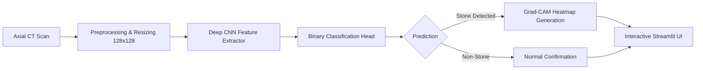

# 🩺 AI Kidney Stone Detection System

[](https://opensource.org/licenses/MIT)
[](https://www.python.org/)
[](https://tensorflow.org/)
[](https://streamlit.io/)
[]()
[]()

An open-source deep learning framework and diagnostic assistive tool designed for the automated detection and localization of kidney stones (nephrolithiasis) from **Axial Computed Tomography (CT) scans**. 

Built with **TensorFlow/Keras**, **OpenCV**, and **Streamlit**, this project bridges high-performance computer vision with clinical explainability through **Grad-CAM (Gradient-weighted Class Activation Mapping)** heatmaps, enabling transparent AI-assisted medical triage.

---

## 🌟 Key Highlights

- **High-Accuracy Classification**: Evaluated on over **32,200+ clinical CT images**, achieving **99.05% validation accuracy** with a custom Deep CNN backbone.
- **Explainable AI (XAI)**: Integrated **Grad-CAM** visual explanation algorithm to highlight the exact spatial regions influencing diagnostic predictions.
- **Comprehensive Benchmark Suite**: Systematic empirical evaluation comparing Pure CNN against Batch, Instance, Group, and Layer Normalization techniques.
- **Interactive Clinical Dashboard**: Clean, responsive Streamlit interface for seamless CT scan uploads, instant inference, and visual feedback.
- **Reproducible Pipeline**: Standardized preprocessing, automated resizing (128×128), and zero-friction local execution.

---

## 📊 Model Benchmark & Performance Metrics

Five convolutional neural network variants were systematically trained and evaluated on the axial CT dataset (6,452 validation images: 2,856 Non-Stone, 3,596 Stone) under identical hyperparameters to determine optimal architectural convergence:

| Architecture / Normalization | Val Accuracy | Precision | Recall | F1-Score | Val Loss | Status |
| :--- | :---: | :---: | :---: | :---: | :---: | :---: |
| **Pure CNN (Proposed)** | **99.05%** | **99.28%** | **99.03%** | **99.15%** | **0.0344** | **Deployed** |
| **Batch Normalization** | 98.10% | 98.42% | 97.80% | 98.11% | 0.0512 | Evaluated |
| **Group Normalization** | 97.33% | 98.58% | 96.61% | 97.59% | 0.0685 | Evaluated |
| **Instance Normalization** | 96.68% | 96.25% | 97.86% | 97.05% | 0.0917 | Evaluated |
| **Layer Normalization** | 81.12% | 82.40% | 80.15% | 81.26% | 0.4120 | Evaluated |

> **Selection Rationale**: The **Pure CNN** configuration demonstrated superior convergence and feature retention for axial CT attenuation values, achieving the highest F1-score (99.15%) and lowest validation loss (0.0344). It is selected as the primary production deployment model (`kidney_stone_pureCNN.keras`).

---

## 🔬 Explainable AI: Grad-CAM Visualization

In clinical computer vision, transparency is essential. Rather than operating as an opaque black box, this system computes gradients of the target class score with respect to the final convolutional feature maps:

$$\alpha_k^c = \frac{1}{Z} \sum_{i} \sum_{j} \frac{\partial y^c}{\partial A_{ij}^k}$$

$$L_{\text{Grad-CAM}}^c = \text{ReLU}\left(\sum_k \alpha_k^c A^k\right)$$

This generates an overlaid visual heatmap pinpointing the precise anatomical location and density cluster of detected calculi.

---

## 📁 Dataset Information

The models were trained on the **Axial CT Imaging Dataset for AI-Powered Kidney Stone Detection** ([Mendeley Data](https://data.mendeley.com/datasets/fwhytt5mzd/2)):

- **Total Slices**: 32,264 Axial CT Images
- **Stone Class**: 17,794 images
- **Non-Stone Class**: 14,470 images
- **Dataset Size**: ~2.16 GB
- **Image Input Dimension**: Resized and normalized to $128 \times 128 \times 3$

*Note: Due to GitHub file size limits, download the full raw dataset directly from the [Mendeley Data repository](https://data.mendeley.com/datasets/fwhytt5mzd/2) and place it in your local directory for retraining.*

---

## 🔄 Processing & Diagnostic Pipeline



1. **Input Ingestion**: User uploads an axial abdominal/pelvic CT scan image (`.png`, `.jpg`, `.jpeg`).
2. **Preprocessing**: Normalization and resizing to $128 \times 128$ matrix for tensor compatibility.
3. **Inference**: Feedforward computation via `kidney_stone_pureCNN.keras`.
4. **Grad-CAM Activation**: Computation of pooled gradients on the terminal convolutional layer.
5. **Report Generation**: Real-time display of diagnostic prediction, confidence score, and explanatory heatmap.

---

## 🚀 Quickstart & Installation

### 1. Prerequisites
Ensure you have **Python 3.10+** installed on your system.

### 2. Clone the Repository
```bash
git clone https://github.com/yashwantsushil850-svg/kidney-stone-detection.git
cd kidney-stone-detection
```

### 3. Create a Virtual Environment (Recommended)
```bash
# Windows
python -m venv venv
venv\Scripts\activate

# Linux / macOS
python3 -m venv venv
source venv/bin/activate
```

### 4. Install Dependencies
```bash
pip install -r requirements.txt
```

### 5. Launch the Application
Run the Streamlit interactive dashboard:
```bash
streamlit run app.py
```
*Windows users can also double-click `run_app.bat` to launch immediately.*

---

## 📂 Repository Structure

```text
kidney-stone-detection/
├── app.py                              # Main Streamlit web application & Grad-CAM pipeline
├── kidney_stone_pureCNN.keras           # Pre-trained Pure CNN model weights (99.05% val acc)
├── requirements.txt                    # Python dependencies (TensorFlow, OpenCV, Streamlit, etc.)
├── run_app.bat                         # One-click Windows startup script
├── LICENSE                             # MIT Open Source License
├── README.md                           # Comprehensive project documentation
├── NOTEBOOKS/
│   └── KidneyStoneDetection5Models.ipynb # Training, evaluation & normalization benchmarks
└── SCREENSHOTS/
    ├── app_interface.png               # Streamlit UI dashboard
    ├── uploaded_image.png              # Input CT scan preview
    ├── stone_detected.png              # Diagnostic output with stone localization
    └── no_stone_detected.png           # Diagnostic output confirming normal scan
```

---

## 🖼️ Application Interface & Previews

| Streamlit Application Dashboard | CT Scan Upload & Analysis |
| :---: | :---: |
|  |  |

| Stone Detected (Positive Diagnosis) | No Stone Detected (Normal) |
| :---: | :---: |
|  |  |

---

## 🛠️ Technology Stack

- **Deep Learning**: TensorFlow 2.10, Keras
- **Computer Vision**: OpenCV (`cv2`), Pillow (PIL)
- **Web Deployment**: Streamlit
- **Data Science & Evaluation**: NumPy, Pandas, Scikit-learn
- **Visualization**: Matplotlib, Seaborn
- **Acceleration**: NVIDIA CUDA / GPU acceleration supported

---

## 🤝 Contributing

Contributions to enhance model architectures, add multi-class segmentation (e.g., U-Net for precise stone boundary delineation), or optimize inference for edge deployment (ONNX / TensorRT) are welcome!

1. Fork the Project
2. Create your Feature Branch (`git checkout -b feature/AmazingFeature`)
3. Commit your Changes (`git commit -m 'Add some AmazingFeature'`)
4. Push to the Branch (`git push origin feature/AmazingFeature`)
5. Open a Pull Request

---

## ⚖️ Clinical Disclaimer

> **Important**: This software is developed strictly for **academic, research, and educational purposes**. It is not certified as a medical diagnostic device and must not replace professional clinical diagnosis, radiologist interpretation, or medical advice.

---

## 📄 License

Distributed under the **MIT License**. See [`LICENSE`](LICENSE) for more information.
